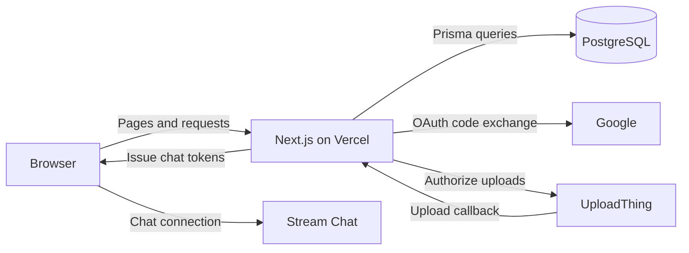
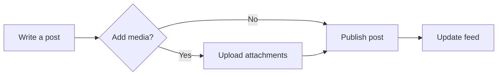

<h1 align="center">Tangle</h1>

A social app for sharing updates, following people, and starting conversations.

  <a href="https://tangle.yusuprd.com"><strong>Open Tangle</strong></a>
  · <a href="#how-it-works">How it works</a>
  · <a href="#local-development">Local development</a>
  · <a href="#project-checks">Project checks</a>

## What you can do

| Area          | In Tangle                                                                                  |
| ------------- | ------------------------------------------------------------------------------------------ |
| Discover      | Browse the For You and Following feeds, search posts, and explore trending hashtags.       |
| Publish       | Write posts with the Tiptap composer and attach photos or videos.                          |
| Connect       | Follow people, edit your profile, like and comment on posts, and bookmark posts for later. |
| Stay in touch | See activity notifications and start private or group conversations.                       |

## How it works

Tangle runs on Vercel with the Next.js App Router, React, and TypeScript. The interface uses Tailwind CSS and Radix UI, and TanStack Query handles client-side fetching and caching.

PostgreSQL stores accounts, sessions, and social activity. UploadThing stores media, and Stream Chat handles conversations and message delivery.

### Publishing a post

The server validates the session and post content before saving the post and linking any uploaded media in PostgreSQL.

## Local development

Use the Node.js version in [`.nvmrc`](.nvmrc) and install dependencies with `npm ci`. Copy [`.env.example`](.env.example) to `.env` and configure the development services.

| Service      | What to configure                                                                                        |
| ------------ | -------------------------------------------------------------------------------------------------------- |
| PostgreSQL   | A pooled URL for app queries and a direct URL for Prisma CLI commands.                                   |
| Google OAuth | A web client ID and secret. Register `http://localhost:3000/api/auth/callback/google` for local sign-in. |
| UploadThing  | The development app ID and its v7 token.                                                                 |
| Stream Chat  | The development app key and server secret.                                                               |

For an empty development database, run `npx prisma db push` to create the schema. Then run `npm run dev` and open [localhost:3000](http://localhost:3000).

## Project checks

| Command                | Purpose                                                |
| ---------------------- | ------------------------------------------------------ |
| `npm run format:check` | Check formatting with Prettier.                        |
| `npm run lint`         | Run ESLint.                                            |
| `npm run typecheck`    | Generate Next.js route types and check TypeScript.     |
| `npm test`             | Run the Vitest suite.                                  |
| `npm run build`        | Build the production app.                              |
| `npm run test:e2e`     | Run the Playwright suite against the production build. |

For browser tests, run `npm run build` and `npx playwright install chromium` before `npm run test:e2e`. The suite uses desktop and mobile browser profiles and starts the app on port 3100.

## Repository layout

| Path                                           | Contents                                             |
| ---------------------------------------------- | ---------------------------------------------------- |
| [`src/app/`](src/app)                          | App Router pages, layouts, and API routes.           |
| [`src/components/`](src/components)            | Shared UI, the post composer, and post interactions. |
| [`src/lib/`](src/lib)                          | Validation, service clients, and shared utilities.   |
| [`prisma/schema.prisma`](prisma/schema.prisma) | PostgreSQL data model.                               |
| [`e2e/`](e2e)                                  | Playwright browser tests.                            |

See [`AGENTS.md`](AGENTS.md) for repository conventions and verification practices.
